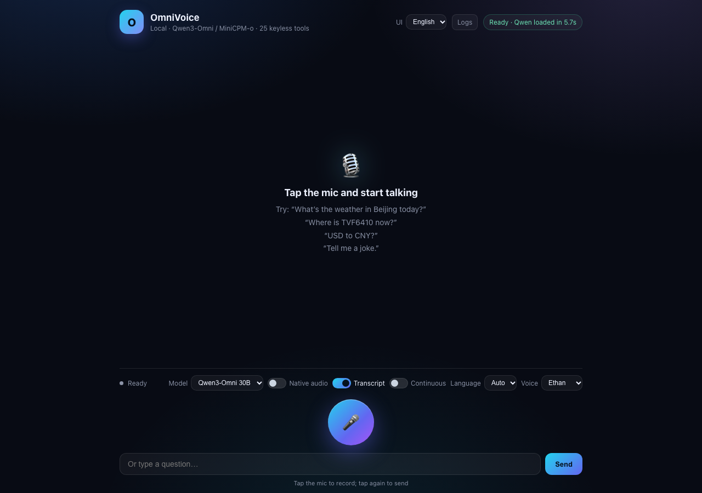
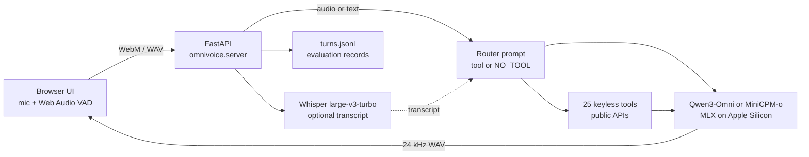

# OmniVoice

**A local, bilingual voice assistant for Apple Silicon.** Talk to Qwen3-Omni or MiniCPM-o 4.5 through a small web UI, with native speech understanding, spoken answers, continuous listening, and 25 keyless public-data tools.

[English](README.md) · [简体中文](README.zh-CN.md)



> Status: alpha / demo. Everything runs on your Mac; no cloud API keys are required.

## Highlights

- **Two local models, one UI** — Qwen3-Omni 30B-A3B (4-bit) and MiniCPM-o 4.5 (MLX 4-bit). Switch models from the toolbar; only one stays resident at a time to fit unified memory.
- **Native audio in, speech out** — the microphone clip goes into the omni model for both the tool decision and the answer, so a misheard transcript cannot hide the right tool; Whisper is an optional transcript probe (`KEEP_TRANSCRIPT`). Answers are synthesized locally and played in the browser.
- **Continuous conversation** — energy-based VAD listens, detects the end of a question, sends it, and resumes after the answer.
- **25 keyless tools** — weather, forecasts, air quality, flights, time, FX, crypto, stocks, country facts, Wikipedia, web search, places, papers, news, holidays, recipes, sports, dictionary, IP, DNS, space weather, earthquakes, ISS, and more.
- **Grounded answers** — a dedicated router prompt forces live-data questions to call a tool; the answer turn is instructed to use only the tool result. If an explicit tool keyword still gets `NO_TOOL`, the decision is retried once; after that, a tool whose arguments can be derived from the text is called directly and marked `forced` in the log.
- **Bilingual UI and prompts** — Chinese/English interface (`界面` / `UI` selector or `?lang=en`), with spoken-unit normalization such as `6.6℃ → 6.6 摄氏度`.
- **Evaluation records** — every turn is appended to `turns.jsonl` with the transcript, tool call, tool result, answer, and timings. Download it from the `记录` / `Logs` button.

## Architecture



## Requirements

- Apple Silicon Mac (M1/M2/M3/M4), macOS with MLX support.
- Python 3.11+ (tested with 3.13).
- **32 GB unified memory minimum; 48 GB+ recommended** for Qwen3-Omni 30B 4-bit. MiniCPM-o 4.5 is much smaller.
- ~30 GB free disk for both models plus Whisper.
- `ffmpeg` for browser audio conversion:
  ```bash
  brew install ffmpeg
  ```
- No API keys. The tools use free public endpoints (Open-Meteo, adsb.lol, Frankfurter/ECB, Wikipedia, DuckDuckGo, Nominatim, Open Library, arXiv, PubMed, Google News RSS, Nager.Date, TheMealDB, ESPN, dictionaryapi.dev, ipapi.co, Google DNS, NOAA SWPC, USGS, wheretheiss.at, Tencent quote, Nasdaq, World Bank).

## Quick start

```bash
git clone https://github.com/chen3feng/omnivoice-mlx.git
cd omnivoice-mlx

python3 -m venv .venv
source .venv/bin/activate
python -m pip install -U pip
pip install -e ".[mlx]"

# Download Qwen3-Omni, MiniCPM-o, and the Whisper ASR model.
python scripts/download_models.py --model all

python -m omnivoice
# open http://127.0.0.1:8000
```

Or use the Makefile:

```bash
make setup
make download
make run
```

The first request after a model switch is slower: the model is loaded lazily and the TTS path is warmed. After that, warm turns are typically a few seconds on an M-series Mac.

## Downloading models in mainland China

Hugging Face can be slow or unreachable. Use the mirror:

```bash
python scripts/download_models.py --model all --mirror
# equivalent to:
export HF_ENDPOINT=https://hf-mirror.com
python scripts/download_models.py --model all
```

For Python packages, a domestic PyPI mirror also works:

```bash
pip install -i https://pypi.tuna.tsinghua.edu.cn/simple -e ".[mlx]"
```

`HF_TOKEN` is only needed if a model repository asks you to accept a license. `--model qwen`, `--model minicpm`, and `--model asr` download one component at a time.

## Using the app

| Action | How |
|---|---|
| Ask by voice | Tap the mic, speak, tap again. |
| Ask by text | Type in the box and press Send. |
| Continuous mode | Toggle `连续对话` / `Continuous`; it sends after ~1 s of silence and resumes after the answer. |
| Native audio | Toggle `原生语音` / `Native audio`; the clip goes to the omni model, which also makes the tool decision. Whisper only provides an optional transcript. |
| Keep transcript | Toggle `保留转写` / `Transcript`; turn it off to skip Whisper in Qwen native mode (faster, no question text in logs). MiniCPM always transcribes. |
| Switch model | Use the `模型` / `Model` selector. The other model is unloaded to free memory. |
| Switch UI language | Use `界面` / `UI`, or open `http://127.0.0.1:8000/?lang=en`. |
| Review answers | Click `记录` / `Logs` to download `turns.jsonl`. |

MiniCPM-o uses reference voices (`assets/voices/ref_zh.wav`, `ref_en.wav`) and ignores the Qwen speaker presets; the speaker selector is disabled for MiniCPM.

## Tools

| Group | Tools |
|---|---|
| Weather | `get_weather`, `get_forecast`, `get_air_quality`, `get_sunrise_sunset`, `get_weather_alerts` |
| Travel | `get_flight`, `search_places`, `get_time` |
| Markets | `get_exchange_rate`, `get_crypto_price`, `get_stock_quote` |
| Knowledge | `get_country_info`, `get_wikipedia`, `search_web`, `search_literature`, `define_word` |
| Daily life | `get_news`, `get_holidays`, `search_recipes`, `get_sports_scores` |
| Network & space | `get_ip_info`, `dns_lookup`, `get_space_weather`, `get_earthquakes`, `get_iss_location` |

Text turns send only a keyword-matched subset of tool schemas. Qwen native voice sends every tool because it hears the clip and a bad transcript must not hide the right schema; MiniCPM keeps the keyword subset because all 25 schemas add about 4 s to its decision on a 9B model. `get_news` returns a single top headline plus its source, so a spoken answer cannot merge two stories; the answer prompts also ask for one headline.

## Evaluation and debugging

Every text or voice turn is appended to `turns.jsonl`:

```json
{
  "id": "20261109-223701-0008",
  "source": "voice",
  "model": "qwen",
  "question": "北京今天天气怎么样?",
  "detected_language": "zh",
  "native": true,
  "decision": "<tool_call>{\"name\":\"get_weather\",\"arguments\":{\"city\":\"北京\"}}</tool_call>",
  "tool": {"name": "get_weather", "arguments": {"city": "北京"}, "result": {"temperature_c": 3.9}},
  "answer": "北京今天天气晴，气温3.9摄氏度，体感温度1.5摄氏度，湿度百分之七十一。",
  "timings": {"probe_s": 3.26, "decide_s": 1.08, "speech_s": 6.39}
}
```

Use it to separate failure modes:

- `decision` has no `<tool_call>` for a live-data question → routing failure.
- `decision_retry` is the second attempt after a keyword-matched `NO_TOOL`.
- `tool.forced` is true when both attempts failed and a safe tool was called directly.
- `question` is null for native Qwen turns when `KEEP_TRANSCRIPT=0`; `route_input` shows `audio`.
- `tool.result` and `answer` disagree → grounding failure.
- `question` is wrong → ASR failure, not a model failure.
- `timings` shows whether time went to ASR, routing, the tool, or TTS.

A repeatable suite is included:

```bash
python scripts/eval_quality.py --model qwen
python scripts/eval_quality.py --model minicpm --out eval-minicpm.jsonl
```

The server must already be running. The script writes one JSON line per turn.

## API

| Endpoint | Purpose |
|---|---|
| `POST /api/transcribe` | Audio file → transcript + detected language. |
| `POST /api/answer` | Text + speaker + model → answer + base64 WAV. |
| `POST /api/answer_audio` | Audio + speaker + model → native-audio answer + base64 WAV. |
| `GET /api/health` | Ready state, loaded model, load time. |
| `GET /api/turns?limit=50` | Recent evaluation records as JSON. |
| `GET /api/turns/download` | Download `turns.jsonl`. |

## Development

```bash
make setup       # create .venv and install .[mlx,dev]
make test        # pytest (no model download needed)
make lint        # ruff check
make check       # lint + format check + tests
make run         # python -m omnivoice
```

The test suite covers the pure tool layer, prompts, and utilities; it does not load MLX models, so it also runs on Linux CI.

Project layout:

```
omnivoice/
  __main__.py        # python -m omnivoice
  server.py          # FastAPI app, pipelines, turn logging
  qwen_omni.py       # Qwen3-Omni MLX wrapper
  minicpm_omni.py    # MiniCPM-o MLX wrapper, key remap, TTS marker fix
  public_tools.py    # 25 keyless tools
  prompts.py         # shared bilingual answer/router prompts
  routing.py         # router retry and safe tool fallback
  utils.py           # pure helpers
web/                 # bilingual UI (HTML/CSS/JS)
assets/voices/       # MiniCPM reference voices
assets/samples/      # one sample WAV
scripts/             # download, run, evaluation
tests/               # pytest suite
```

## Configuration

| Variable | Default | Meaning |
|---|---|---|
| `HOST` | `127.0.0.1` | Bind address. |
| `PORT` | `8000` | HTTP port. |
| `ASR_MODEL` | `mlx-community/whisper-large-v3-turbo` | Whisper repo or local path. |
| `KEEP_TRANSCRIPT` | `1` | Native Qwen voice routes on audio; set `0` to skip the Whisper transcript probe (faster, no question text in logs). |
| `MLX_WIRED_LIMIT_GB` | `30` | Wired-memory limit. Lower it on a 32 GB Mac. |
| `HF_ENDPOINT` | unset | Set to `https://hf-mirror.com` for the China mirror. |
| `HF_TOKEN` | unset | Only for gated model repositories. |

No `.env` file is needed. If you create one, it is gitignored.

## Troubleshooting

- **First request takes a long time** — the model is loading and warming the TTS path. Watch `/api/health`; subsequent turns are faster.
- **Memory pressure / swap** — only one model is resident. Close heavy apps, or set `MLX_WIRED_LIMIT_GB` lower. MiniCPM-o is the lighter choice.
- **MiniCPM-o will not load** — the MLX checkpoint uses the official PyTorch key names; OmniVoice remaps `vision_tower.encoder_layers.*` and `audio_encoder.*` at load time. Keep `minicpm_omni.py` with the rest of the package.
- **MiniCPM-o speech is incomplete after a tool call** — the model sometimes emits `<|im_end|>` instead of `<|tts_eos|>`; the wrapper fixes the final token before the vocoder.
- **ASR drifts into another language** — the app forces Chinese/English Whisper prompts and picks the higher-confidence result in auto mode.
- **No microphone in the browser** — use `http://127.0.0.1` (not a remote host) or HTTPS; browsers restrict microphone access on insecure origins.
- **`ffmpeg` not found** — install it with `brew install ffmpeg`.

## Model licenses

The code is MIT-licensed. Model weights are downloaded separately and remain under their own licenses; check the model cards before redistribution:

- `mlx-community/Qwen3-Omni-30B-A3B-Instruct-4bit`
- `andrevp/MiniCPM-o-4_5-MLX-4bit`
- `mlx-community/whisper-large-v3-turbo`

## Contributing

Issues and pull requests are welcome. Before opening a PR:

```bash
make check
```

Please keep the tool layer keyless and the prompts bilingual.

## License

MIT. See [LICENSE](LICENSE).
