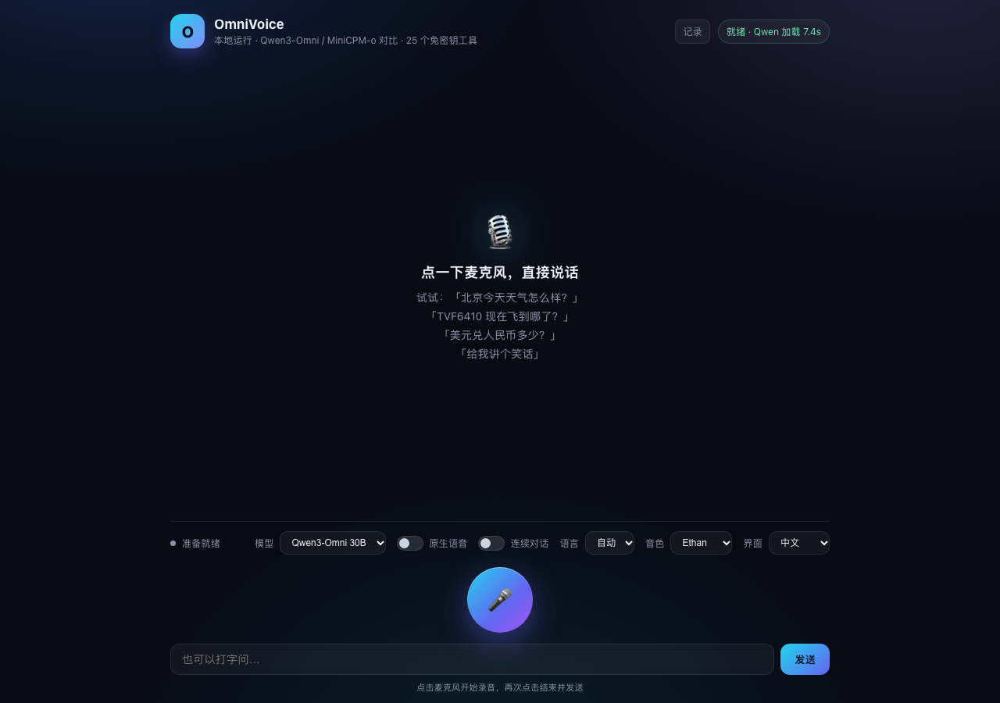
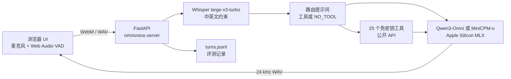

# OmniVoice

**运行在 Apple Silicon 上的本地双语语音助手。** 通过一个小型 Web UI 与 Qwen3-Omni 或 MiniCPM-o 4.5 对话，支持原生语音理解、语音回答、连续对话，以及 25 个免密钥公开数据工具。

[English](README.md) · [简体中文](README.zh-CN.md)



> 状态：alpha / 演示项目。全部在本机运行，不需要任何云端 API Key。

## 特性

- **两个本地模型，一个界面** —— Qwen3-Omni 30B-A3B（4-bit）与 MiniCPM-o 4.5（MLX 4-bit）。工具栏可切换；同一时间只驻留一个模型，避免统一内存被撑爆。
- **原生语音输入，语音输出** —— 麦克风音频可以直接送入 omni 模型；Whisper 只负责语种判断和工具路由。回答在本地合成，浏览器播放。
- **连续对话** —— 基于能量的 VAD 持续监听，自动判断问题结束，发送并等待回答，然后继续听。
- **25 个免密钥工具** —— 天气、预报、空气质量、航班、时间、汇率、加密货币、股票、国家信息、维基百科、网页搜索、地点、论文、新闻、节假日、菜谱、体育比分、词典、IP、DNS、空间天气、地震、国际空间站等。
- **回答有依据** —— 决策轮使用严格的路由提示词，实时数据问题必须调用工具；回答轮被要求只使用工具结果。如果命中了明确的关键词却仍返回 `NO_TOOL`，会再重试一次决策；仍然失败时，直接调用参数可以从问题文本推导出的安全工具，并在日志里标记 `forced`。
- **中英文双语 UI 与提示词** —— `界面` / `UI` 切换，或使用 `?lang=en`；数字按口语化单位输出，例如 `6.6℃ → 6.6 摄氏度`。
- **评测记录** —— 每轮问答写入 `turns.jsonl`，包含转写、工具调用、工具结果、回答和耗时；点击 `记录` / `Logs` 下载。

## 架构



## 环境要求

- Apple Silicon Mac（M1/M2/M3/M4），支持 MLX 的 macOS。
- Python 3.11+（已在 3.13 上测试）。
- **至少 32 GB 统一内存，推荐 48 GB+**（Qwen3-Omni 30B 4-bit 约占 20 GB）；MiniCPM-o 4.5 小很多。
- 约 30 GB 可用磁盘（两个模型 + Whisper）。
- `ffmpeg`，用于浏览器音频转码：
  ```bash
  brew install ffmpeg
  ```
- 不需要 API Key。工具全部使用免费公开接口（Open-Meteo、adsb.lol、Frankfurter/ECB、Wikipedia、DuckDuckGo、Nominatim、Open Library、arXiv、PubMed、Google News RSS、Nager.Date、TheMealDB、ESPN、dictionaryapi.dev、ipapi.co、Google DNS、NOAA SWPC、USGS、wheretheiss.at、腾讯行情、Nasdaq、World Bank）。

## 快速开始

```bash
git clone https://github.com/chen3feng/omnivoice-mlx.git
cd omnivoice-mlx

python3 -m venv .venv
source .venv/bin/activate
python -m pip install -U pip
pip install -e ".[mlx]"

# 下载 Qwen3-Omni、MiniCPM-o 和 Whisper ASR 模型
python scripts/download_models.py --model all

python -m omnivoice
# 打开 http://127.0.0.1:8000
```

也可以使用 Makefile：

```bash
make setup
make download
make run
```

切换模型后的第一次请求会慢一些：模型懒加载，并会预热 TTS 路径。之后在 M 系列 Mac 上通常是几秒一轮。

## 国内网络下载模型

Hugging Face 可能很慢或无法访问，使用镜像：

```bash
python scripts/download_models.py --model all --mirror
# 等价于：
export HF_ENDPOINT=https://hf-mirror.com
python scripts/download_models.py --model all
```

Python 包也可以用国内 PyPI 镜像：

```bash
pip install -i https://pypi.tuna.tsinghua.edu.cn/simple -e ".[mlx]"
```

只有模型仓库要求接受许可时才需要 `HF_TOKEN`。`--model qwen`、`--model minicpm`、`--model asr` 可以单独下载某个组件。

## 使用

| 操作 | 方法 |
|---|---|
| 语音提问 | 点一下麦克风，说话，再点一下结束。 |
| 文字提问 | 在输入框输入，按发送。 |
| 连续对话 | 打开 `连续对话` / `Continuous`；停顿约 1 秒自动发送，回答结束后继续听。 |
| 原生语音 | 打开 `原生语音` / `Native audio`；音频送入 omni 模型，Whisper 仍负责工具路由。 |
| 切换模型 | 使用 `模型` / `Model` 选择器；另一个模型会被卸载以释放内存。 |
| 切换界面语言 | 使用 `界面` / `UI`，或打开 `http://127.0.0.1:8000/?lang=en`。 |
| 回看回答 | 点击 `记录` / `Logs` 下载 `turns.jsonl`。 |

MiniCPM-o 使用参考音色（`assets/voices/ref_zh.wav`、`ref_en.wav`），不使用 Qwen 的音色预设；切到 MiniCPM 时音色选择器会被禁用。

## 工具列表

| 分组 | 工具 |
|---|---|
| 天气 | `get_weather`、`get_forecast`、`get_air_quality`、`get_sunrise_sunset`、`get_weather_alerts` |
| 出行 | `get_flight`、`search_places`、`get_time` |
| 市场 | `get_exchange_rate`、`get_crypto_price`、`get_stock_quote` |
| 知识 | `get_country_info`、`get_wikipedia`、`search_web`、`search_literature`、`define_word` |
| 生活 | `get_news`、`get_holidays`、`search_recipes`、`get_sports_scores` |
| 网络与太空 | `get_ip_info`、`dns_lookup`、`get_space_weather`、`get_earthquakes`、`get_iss_location` |

路由层每轮只发送关键词匹配到的工具子集，既缩短提示词，也提高工具选择准确率。`get_news` 只返回一条最重要的标题和来源，避免语音答案把两条新闻合并；回答提示词也要求只播报一条。

## 评测与调试

每轮文本或语音问答都会追加到 `turns.jsonl`：

```json
{
  "id": "20261109-223701-0008",
  "source": "voice",
  "model": "qwen",
  "question": "北京今天天气怎么样?",
  "detected_language": "zh",
  "native": true,
  "decision": "<tool_call>{\"name\":\"get_weather\",\"arguments\":{\"city\":\"北京\"}}</tool_call>",
  "tool": {"name": "get_weather", "arguments": {"city": "北京"}, "result": {"temperature_c": 3.9}},
  "answer": "北京今天天气晴，气温3.9摄氏度，体感温度1.5摄氏度，湿度百分之七十一。",
  "timings": {"probe_s": 3.26, "decide_s": 1.08, "speech_s": 6.39}
}
```

可以据此区分问题类型：

- 实时数据问题里 `decision` 没有 `<tool_call>` → 路由失败。
- `decision_retry` 是命中关键词后第一次 `NO_TOOL` 的第二次决策。
- `tool.forced` 为 true → 两次决策都失败，直接调用了安全的兜底工具。
- `tool.result` 与 `answer` 不一致 → 回答没有接地（幻觉）。
- `question` 本身错了 → ASR 问题，不是模型问题。
- `timings` 可以看时间花在 ASR、路由、工具还是 TTS。

内置可重复评测脚本：

```bash
python scripts/eval_quality.py --model qwen
python scripts/eval_quality.py --model minicpm --out eval-minicpm.jsonl
```

需要服务已经启动。脚本每轮写一行 JSON。

## API

| 端点 | 用途 |
|---|---|
| `POST /api/transcribe` | 音频文件 → 转写 + 语种。 |
| `POST /api/answer` | 文本 + 音色 + 模型 → 回答 + base64 WAV。 |
| `POST /api/answer_audio` | 音频 + 音色 + 模型 → 原生语音回答 + base64 WAV。 |
| `GET /api/health` | 就绪状态、当前模型、加载耗时。 |
| `GET /api/turns?limit=50` | 最近的评测记录（JSON）。 |
| `GET /api/turns/download` | 下载 `turns.jsonl`。 |

## 开发

```bash
make setup       # 创建 .venv 并安装 .[mlx,dev]
make test        # pytest（不需要下载模型）
make lint        # ruff check
make check       # lint + 格式检查 + 测试
make run         # python -m omnivoice
```

测试覆盖纯工具层、提示词和工具函数，不加载 MLX 模型，因此也能在 Linux CI 上运行。

项目结构：

```
omnivoice/
  __main__.py        # python -m omnivoice
  server.py          # FastAPI、流水线、评测记录
  qwen_omni.py       # Qwen3-Omni MLX 封装
  minicpm_omni.py    # MiniCPM-o MLX 封装、权重 key 重映射、TTS 结束符修复
  public_tools.py    # 25 个免密钥工具
  prompts.py         # 中英文回答/路由提示词
  routing.py         # 路由重试与安全兜底
  utils.py           # 纯工具函数
web/                 # 双语 UI（HTML/CSS/JS）
assets/voices/       # MiniCPM 参考音色
assets/samples/      # 一个示例 WAV
scripts/             # 下载、运行、评测
tests/               # pytest
```

## 配置

| 环境变量 | 默认值 | 说明 |
|---|---|---|
| `HOST` | `127.0.0.1` | 监听地址。 |
| `PORT` | `8000` | HTTP 端口。 |
| `ASR_MODEL` | `mlx-community/whisper-large-v3-turbo` | Whisper 仓库或本地路径。 |
| `MLX_WIRED_LIMIT_GB` | `30` | Wired 内存上限；32 GB 机器建议调低。 |
| `HF_ENDPOINT` | 未设置 | 设为 `https://hf-mirror.com` 使用国内镜像。 |
| `HF_TOKEN` | 未设置 | 仅用于需要授权的模型仓库。 |

不需要 `.env` 文件；如果创建，它已被 gitignore。

## 常见问题

- **第一次请求很慢** —— 模型正在加载并预热 TTS。看 `/api/health`，之后的轮次会快很多。
- **内存压力 / swap** —— 同一时间只驻留一个模型。关掉占用内存的应用，或调低 `MLX_WIRED_LIMIT_GB`；MiniCPM-o 更轻。
- **MiniCPM-o 加载失败** —— MLX checkpoint 使用官方 PyTorch 的 key 名；OmniVoice 在加载时重映射 `vision_tower.encoder_layers.*` 和 `audio_encoder.*`。不要把 `minicpm_omni.py` 从包里拆出去。
- **MiniCPM-o 工具调用后语音不完整** —— 模型有时输出 `<|im_end|>` 而不是 `<|tts_eos|>`；封装层会在送入 vocoder 前修正最后一个 token。
- **ASR 漂移到其他语言** —— 应用强制使用中/英文 Whisper 提示词，自动模式取置信度更高的结果。
- **浏览器没有麦克风权限** —— 使用 `http://127.0.0.1`（不要用远程主机）或 HTTPS；浏览器限制非安全来源的麦克风。
- **找不到 `ffmpeg`** —— `brew install ffmpeg`。

## 模型许可

代码使用 MIT 许可。模型权重单独下载，遵循各自的模型许可；再分发前请查看模型卡：

- `mlx-community/Qwen3-Omni-30B-A3B-Instruct-4bit`
- `andrevp/MiniCPM-o-4_5-MLX-4bit`
- `mlx-community/whisper-large-v3-turbo`

## 贡献

欢迎提 Issue 和 PR。提交前请运行：

```bash
make check
```

请保持工具层免密钥、提示词中英文双语。

## 许可

MIT，见 [LICENSE](LICENSE)。
